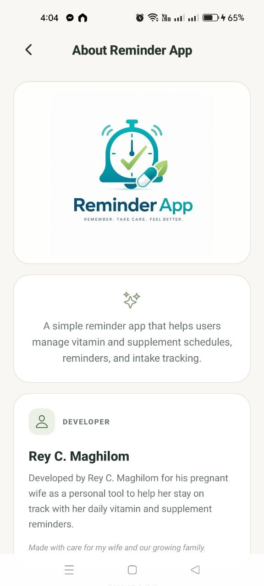
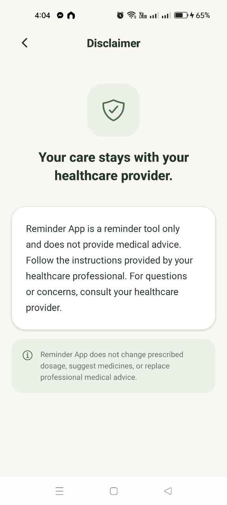
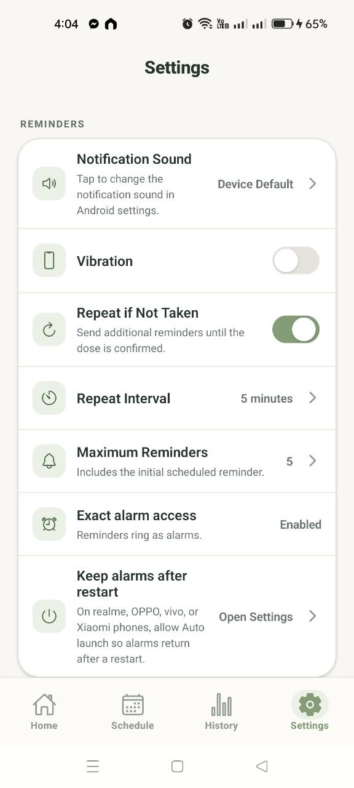
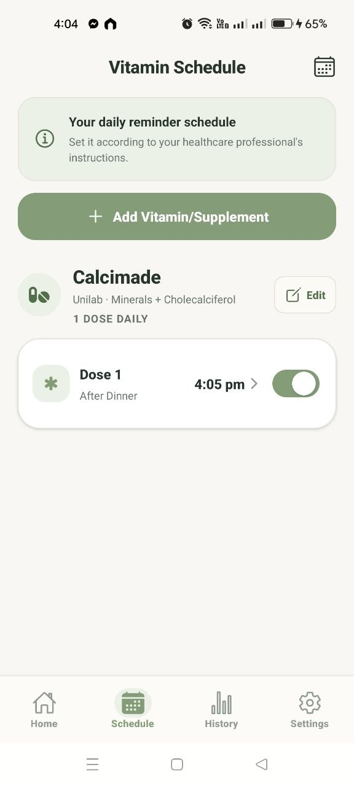
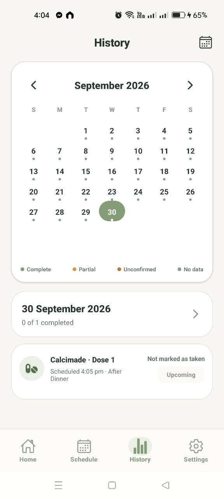

# Reminder App

An offline-first mobile app for scheduling daily vitamin and supplement reminders and keeping a record of each dose taken.

## Overview

Reminder App is a personal project I built for my wife during her pregnancy. She needed a simple way to keep several daily vitamins and supplements on schedule, each with its own timing, and to be sure whether a dose had already been taken that day.

The app lets her set up each supplement with one or more daily doses, get a reminder at each scheduled time, and confirm the dose with a single tap. Everything is stored on the device, so it works without an account or an internet connection. It is a reminder and tracking tool only and gives no medical advice.

## Key Features

- **Flexible dose scheduling:** add vitamins or supplements with up to six daily doses, each set to a meal period (after breakfast, lunch or dinner, or bedtime) or a custom label and time.
- **Alarm-style reminders on Android:** a custom native Kotlin module schedules exact alarms that play a looping tone on a full-screen alarm screen, with "Mark as taken" and "Stop" actions. If exact-alarm access is off, the app uses standard local notifications instead.
- **Alarm restoration:** the app reschedules alarms after a device reboot, an app update, or a time or timezone change, and keeps upcoming alarms scheduled 14 days ahead. Some Android manufacturers' battery settings can still block this.
- **Repeat until taken:** optional follow-up reminders at a set interval (5 to 30 minutes), up to a chosen maximum, which stop once the dose is confirmed.
- **Daily progress and history:** a home timeline shows each dose as upcoming, due, taken or unconfirmed, and a monthly calendar lets her review any past day.
- **Local SQLite storage:** a versioned schema with migrations, plus snapshot fields so past history stays correct after a schedule is edited.
- **Settings:** light and dark themes, vibration, a test notification, and options to reset intake history or all app data.

## Application Screenshots

<p align="center">
  
  
  
</p>

<p align="center">
  
  
</p>

## Technology Stack

| Category | Technologies |
|---|---|
| Mobile Framework | React Native 0.81, Expo SDK 54 (New Architecture enabled) |
| Programming Language | TypeScript, Kotlin (native Android alarm module) |
| Database / Storage | SQLite via `expo-sqlite` |
| Notifications / Alarms | `expo-notifications`, Android `AlarmManager` with a foreground service and a full-screen alarm screen |
| State Management | Zustand |
| UI / Navigation | Expo Router (tab and stack navigation), `@expo/vector-icons`, `@react-native-community/datetimepicker`, `expo-haptics` |
| Development Tools | Expo Modules API, Expo Dev Client, EAS Build, ESLint |

## Getting Started

```bash
npm install
npx expo run:android   # builds a development client with the native alarm module
```

The app also runs in Expo Go with `npx expo start`, but it only uses standard notifications there because Expo Go cannot load custom native modules. Reminders need a physical device with notification permission granted.

```bash
npm run typecheck
npm run lint
```

## Developer

- **Developer:** Rey C. Maghilom
- **Project Type:** Personal mobile application
- **Development Role:** Independent mobile app developer

I designed and built this app on my own for my wife during her pregnancy, from the data model and UI to the native Android alarm scheduling.

## Project Status

Version 1.0.0 was developed for personal use and mainly targets Android. iOS is configured in the project but has not been verified, and the native Kotlin alarms work on Android only. The app is not published on Google Play or the App Store.
